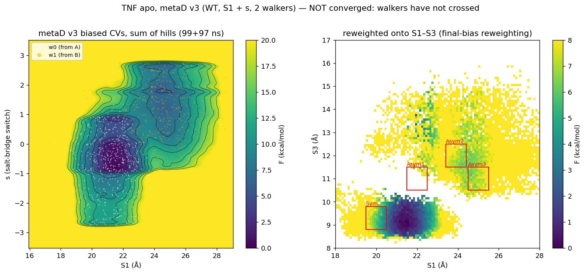

# Example: TNF-α symmetric ↔ asymmetric trimer (apo)

**Question.** How much does it cost the apo TNF-α trimer to adopt the asymmetric
conformation that small-molecule inhibitors stabilize (PDB 7JRA), relative to the
symmetric trimer (PDB 1TNF)?

**CVs** (from bioRxiv 10.1101/2025.11.28.690881): three center-of-mass distances between Cα
groups on the distorted chain C → chain A interface (ECD numbering = precursor − 76):

| CV | chain C residues | chain A residues | 1TNF | 7JRA |
|---|---|---|---|---|
| S1 | 54–56, 124–126 | 54–56, 124–126 | 19.90 Å | 24.16 Å |
| S2 | 93–98, 117–122 | 60–64, 116–119, 150–152 | 8.61 Å | 12.00 Å |
| S3 | 75–77, 97–99 | 64–66, 114–116 | 9.43 Å | 14.01 Å |

Salt-bridge switch `s` (v3): Σ over the three interfaces of
c(Lys112–Glu104) − c(Arg103–Glu104), from −3 (all A-like) to +3 (all B-like).

7JRA chains are remapped C→A, B→B, A→C to match the simulation, and the ligand is removed.

**System.** ff14SB / TIP3P / 150 mM KCl, 310 K, 4 fs with HMR, 12 Å cutoff (switch from 10 Å),
~76k atoms; staged 9 ns restrained equilibration of each end state.

## Runs

| Run | Biased CVs | Walkers | Length | Inputs |
|---|---|---|---|---|
| v2 | S1, S3 | 2 (one from A, one from B) | 208 + 67 ns | `inputs/plumed_v2_S1_S3_walker0.dat` |
| v3 | S1, s (S3 printed + walls only) | 2 | 100 + 98 ns | `inputs/plumed_v3_S1_s_walker0.dat` |

WT-metaD: biasfactor 15, height 1.2 kJ/mol, pace 1000 steps, σ = 0.025 nm (S1), 0.10 (s).
(The paper used meta-eABF; PLUMED's DRR module was not available, so this is WT-metaD on
the same CVs. Keep that in mind when comparing numbers.)

## Results

- **Both basins were found where expected.** A (S1 ≈ 21 Å, S3 ≈ 9 Å) matches 1TNF, and B
  (S1 22–26 Å, S3 11–15 Å) is on the 7JRA side. Gen-COMPAS put them in the same places.
- **No converged free energy.** In v3 neither walker crossed in S3 in ~100 ns each. w0
  stayed at S3 < 10 Å in 98% of frames and w1 never went below 10 Å, so the
  reweighted S1–S3 map is two disconnected islands. The ±0.3 Å window dG(B−A) drifted
  +4.5 → +2.3 → +4.4 kcal/mol over 20–97 ns, and the S1-split dG swung between −1.8 and
  +2.6. Not reportable.
- **Why:** S3 is the coordinate that opens first along the transition path, and it was not
  biased in v3. v2 biased S3 but its B walker escaped to very high S3 (15–19 Å).
  A v4 with S1 + S3 biased and tighter S3 walls is the logical next step.



## Reproduce the analysis

```bash
python analysis/fes_reweight.py --hills HILLS.0 HILLS.1 --colvar COLVAR.w0 COLVAR.w1 \
    --bias-cols 1 4 --proj-cols 1 3 --proj-scale 10 10 --temp 310 --biasfactor 15 \
    --grid 1.6 2.9 131 -3.5 3.5 141 --state-a 21.42 9.07 --state-b 21.98 13.72 \
    --time-blocks 10000 --out fes_v3.png
```

HILLS/COLVAR files are not stored in the repo (about 25 MB per run). They are available on request.
